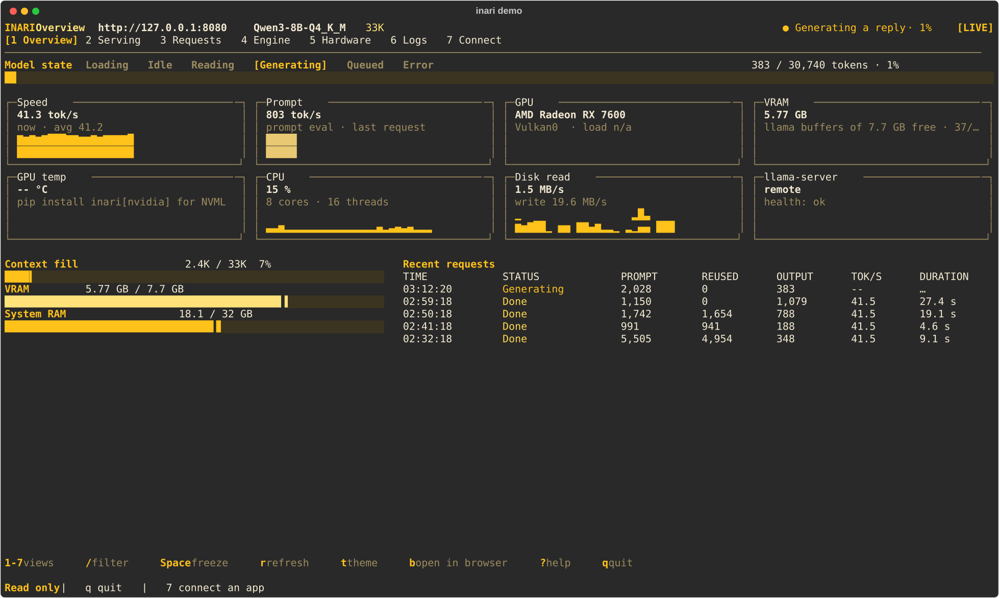

# Inari 🦊

llama.cpp の `llama-server` を、黄色基調の豪華なモニタリング TUI 付きで扱うラッパー。



- **HuggingFace から GGUF をダウンロード** — TUI で検索 → 量子化を選んでダウンロード、または `repo:QUANT` 指定。分割 GGUF、mmproj に対応。保存先は llama.cpp の `-hf` と同じ Hugging Face キャッシュで、Xet / HTTP を切り替え可能
- **起動引数のプロファイル化** — `~/.inari/profiles/*.toml` に保存
- **モニタリング TUI** — 7 ビュー（Overview / Serving / Requests / Engine / Hardware / Logs / Connect）
- **バックグラウンド起動** — TUI を閉じてもサーバーは動いたまま。`inari monitor` で再接続できる

## セットアップ

```bash
uv sync
uv run inari config set llama_server C:/llama.cpp/build/bin/llama-server.exe   # PATH に無い場合
```

NVIDIA GPU で負荷・温度・電力も見たいときは: `uv sync --extra nvidia`

## 使い方

### メインメニュー

```bash
uv run inari                    # 引数なしで起動するとメインメニュー
```

保存済みプロファイルの一覧（モデル・ポート・起動状態）から選んで `Enter` で起動＆モニタ表示（起動中ならモニタに再接続）。`1`〜`9` で直接起動、`e` で選択中のプロファイルをセットアップウィザードで編集、`n` で新規セットアップ、`h` で Hub、`x` で起動中のサーバーを停止、`d` / `Del` で選択中のプロファイルを削除（確認モーダルあり。モデルファイルは残ります）、`q` で終了。モニタやウィザードを閉じるとメニューに戻ります。全コマンドの一覧は `inari --help`（パイプ等で TTY でないときは従来どおりコマンド一覧を表示）。

### セットアップウィザード（はじめての方はここから）

```bash
uv run inari setup              # = inari onboard。新しいプロファイルを対話的に作成
uv run inari setup qwen3-8b     # 既存プロファイルを編集
uv run inari setup qwen3-8b -a  # 全設定テーブル（Advanced）を直接開く
```

llama-server → モデル（`h` で Hub からダウンロード、`d` / `Del` でローカルのモデルを確認モーダル付きで削除）→ 名前 → コンテキスト & KV キャッシュ → GPU オフロード → チャット / サンプリング → ネットワーク → **Advanced** → 確認・保存、の 9 ステップ。どのステップでも下部に「実行されるコマンド」が表示されます。

- **Advanced** は、設定済み llama-server の `--help` から読み取った全フラグを `Default`（llama.cpp 既定）/ `Tuned`（inari の推奨）/ `Yours`（あなたの値）で一覧表示。`/` 絞り込み、`x` experimental のみ、`Enter` 編集、`←→` 選択肢切替、`Del` リセット、`a` 名前で追加、`c` コマンドをコピー、`u` Tuned 値の適用 on/off
- **Tuned** は `llama-server --list-devices` の VRAM と GGUF メタデータ（学習時コンテキスト長、層数、MoE など）から計算
- `--help` の解析結果はビルドごとに `~/.inari/cache/` にキャッシュ

```bash
# Hugging Face を TUI で検索してダウンロード（→ 完了後 p でプロファイル作成）
uv run inari hub qwen3 8b

# ダウンロード（候補表から選ぶ or :QUANT で直接指定）→ そのままプロファイル作成
uv run inari pull unsloth/Qwen3-8B-GGUF:Q4_K_M -p qwen3-8b
uv run inari pull unsloth/Qwen3-8B-GGUF:Q4_K_M --via http   # バックエンドを指定（auto / xet / http）

# ローカルのモデル一覧（HF キャッシュ + models_dir）
uv run inari models

# プロファイル編集
uv run inari profile set qwen3-8b ctx-size=32768 flash-attn=on "-ot=exps=CPU" extra+=--no-webui
uv run inari profile show qwen3-8b
uv run inari profile ls

# 起動してモニタ
uv run inari serve              # router モード：全プロファイルを 1 ポートで（モデルは要求に応じてロード）
uv run inari serve -l qwen3-8b  # router モード + 起動時に qwen3-8b をロード
uv run inari serve qwen3-8b     # 1 プロファイルだけを単体で起動
uv run inari monitor            # 再接続
uv run inari monitor --url http://127.0.0.1:8080   # 外部で起動したサーバーを読み取り専用で監視
uv run inari ps / inari stop qwen3-8b

# モデル無しで TUI を試す
uv run inari demo
```

### router モード（`inari serve`）

プロファイル名を付けずに `inari serve` を実行すると、llama-server を [router モード](https://github.com/ggml-org/llama.cpp/tree/master/tools/server#using-multiple-models) で起動し、そのままモニタを開きます。

- すべてのプロファイルを、プロファイル名をセクション名にしたモデルプリセットとして `~/.inari/router/presets.ini` に書き出します（起動のたびに再生成）。HF キャッシュ内のモデルは llama-server 自身が一覧に追加します
- リクエストの `"model": "<プロファイル名>"` で使うモデルを選びます。未ロードのモデルは最初のリクエストで自動的にロードされます
- オプション：`--port`（既定 8080）、`--host`、`-l/--load PROFILE`（起動時にロード、複数指定可）、`--models-max N`（同時にロードするモデルの上限）
- モニタの **8 Models** タブ：`Enter` でロードしてそのモデルのモニタを表示、`u` でアンロード。表示中のモデルは、処理中または最後にロードされたモデルに自動で切り替わります（`m` で手動で次のモデルへ、`f` で自動追従に戻す）。Requests にはモデル名の列が付きます
- 再接続は `inari monitor router`、停止は `inari stop router`（各モデルのプロセスもまとめて停止）。メインメニューでは `r` で起動・再接続できます
- プロファイルの `host` / `port` は router では使われません。`LLAMA_ARG_*` 以外の `env` は router 全体に適用されます

### プロファイルの書式

```toml
description = "Qwen3 8B"
model = "hf://unsloth/Qwen3-8B-GGUF/Qwen3-8B-Q4_K_M.gguf"   # HF キャッシュ参照 / models_dir からの相対パス / 絶対パス
host = "127.0.0.1"
port = 8080
extra = ["--no-webui"]          # そのまま末尾に追加

[args]                          # --key value / true は単独フラグ / false は省略
ctx-size = 32768
n-gpu-layers = 99
jinja = true
flash-attn = "on"
"-ot" = "exps=CPU"              # '-' で始まるキーはそのまま使う

[env]
GGML_VK_VISIBLE_DEVICES = "0"
```

`--metrics` はモニタが使うので自動で付与されます。`hf://owner/repo/file` という値（`model` や `mmproj` など）は、起動時に HF キャッシュ内のファイルパスに変換されます。

### モデルの保存先と llama.cpp との共有

ダウンロードしたモデルは **Hugging Face キャッシュ**（`~/.cache/huggingface/hub/models--owner--repo/`）に保存されます。llama.cpp の `-hf` や `huggingface-cli` と同じ場所・同じ形式なので、

- `inari pull` したモデルは `llama-server -hf owner/repo:QUANT` で再ダウンロードなしに使える
- `llama-server -hf` で落としたモデルも `inari models` に出てきて、プロファイルから使える
- 途中まで落としたファイル（`blobs/<sha256>.downloadInProgress`）は、HTTP なら inari と llama.cpp のどちらからでも再開できる
- 同じファイルを同時に落とそうとすると、片方が待つ（`.locks/` のロックを共有）

キャッシュの場所は llama.cpp と同じ順で決まります: `LLAMA_CACHE` → `HF_HUB_CACHE` → `HUGGINGFACE_HUB_CACHE` → `HF_HOME/hub` → `XDG_CACHE_HOME/huggingface/hub` → `~/.cache/huggingface/hub`。`inari config set hf_cache <dir>` で個別に指定した場合は、inari から起動する llama-server にも `LLAMA_CACHE` として渡します。

**ダウンロード方式**は `inari config set download_backend auto|xet|http`、`pull --via ...`、Hub TUI の `v` キーで切り替えられます。

| 方式 | 内容 |
|---|---|
| `auto`（既定） | `hf_xet` が入っていれば Xet。HTTP の途中ファイルがあるときは HTTP で再開 |
| `xet` | Xet（`hf_xet`）で取得。速いが、中止すると最初からやり直し |
| `http` | 普通の HTTP。Range で途中から再開できる |

以前の版で `~/.inari/models/owner__repo/` に落としたモデルは、`inari models migrate` で HF キャッシュへ移動できます。それを参照しているプロファイルも書き換えます。移行しなくても、これまで通り読み込めます。

### Hub（検索 TUI）のキー

| キー | 動作 |
|---|---|
| `/` | 検索語を入力（Enter で検索） |
| `o` | 並び順切替（downloads / trending / likes / updated） |
| `↑` `↓` `Enter` | リポジトリを選んでファイル一覧へ |
| `Enter` / `d` | 選んだ量子化をダウンロードキューに追加 |
| `m` | vision projector（mmproj）も一緒に落とす |
| `v` | ダウンロード方式を切替（auto / xet / http）。次に追加するダウンロードから有効 |
| `Tab` | ダウンロード一覧へ移動 → `p` でプロファイル作成、`x` でキャンセル |
| `Esc` | 戻る |
| `b` | Hugging Face のページをブラウザで開く |

### モニタのキー

| キー | 動作 |
|---|---|
| `1`–`7` / `←` `→` | ビュー切替 |
| `/` | フィルタ（Logs: 文字列, Requests: ステータス・タスク ID） |
| `Space` | 表示を一時停止 |
| `r` | 即時更新 |
| `t` | テーマ選択（説明とカラープレビュー付き。↑↓ で即プレビュー、Enter で決定、Esc で戻す）: kitsune（既定）/ sora 水色 / matcha 緑 / sumi モノクロ / washi ライト端末用 |
| `b` | llama.cpp の Web UI をブラウザで開く |
| `↑` `↓` `PgUp` `PgDn` `End` | ログ・リクエストのスクロール |
| `q` | 終了（管理中サーバーは「停止 / 動かしたまま」を選択） |

## データの取り方

- `/health` `/props` `/slots` `/metrics` を 0.5 秒ごとにポーリング
- サーバーログ（`~/.inari/logs/`）を tail して、デバイス・VRAM バッファ・オフロード層数・リクエスト履歴（prompt / キャッシュ再利用 / 出力 / tok/s / 所要時間）を抽出
- CPU / RAM / ディスク I/O / サーバープロセスは psutil、NVIDIA GPU は NVML（任意）

AMD / Intel GPU では負荷・温度は表示されませんが、VRAM 使用量は llama.cpp のバッファサイズから推定します。

保存先は `INARI_HOME`（既定 `~/.inari`）。ダウンロードは HF キャッシュ（上記）に入ります。手で置いた GGUF 用の `models_dir` は `INARI_MODELS` か `inari config set models_dir ...` で変更できます。
